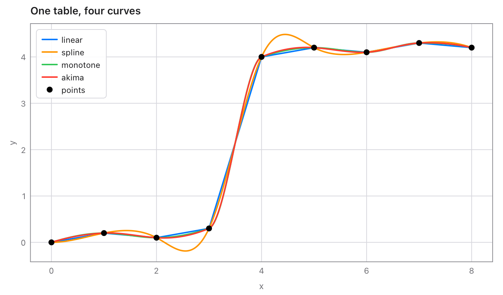

# interpolate

Interpolation for [Tessel](https://tessel-lang.syncster.dev) programs:
values between the points of a table, by straight lines, smooth splines,
a curve that keeps the data's shape, Akima's curve or steps, and two-way
tables. Every curve also gives slopes, areas, and the x for a y (reading a
table backwards). The curves are the same as SciPy's, checked on 900
random tables.

```tessel
import interpolate

fn main() {
    // A rating table: discharge (m³/s) for water depths (m).
    let depth = [0.5, 1.0, 1.5, 2.0, 2.5]
    let flow = [8.2, 23.0, 42.5, 66.0, 93.1]
    let rating = interpolate.monotone(depth, flow)
    print(rating.at(1.2))                    // the flow at 1.2 m
    print(rating.xFor(50.0) ?? 0.0)          // the depth for 50 m³/s
}
```

```text
30.241090785815985
1.6691580566455806
```



## Using it

Add it to a project (Tessel 0.8 or later):

```sh
tessel add interpolate
```

then `import interpolate`.

## Making a curve

Each takes the xs and the ys of the points (in any order; they're sorted
by x) and gives an `Interpolant`.

| Function | The curve |
|---|---|
| `linear(xs, ys)` | Straight lines from point to point, as when reading a table by hand. |
| `spline(xs, ys, start:, end:)` | The smooth cubic spline: no jumps in slope or bending. |
| `monotone(xs, ys)` | Smooth, and keeps the data's shape: rises where the points rise, falls where they fall, never overshoots a point (SciPy's `PchipInterpolator`, MATLAB's `pchip`). The safe choice for tables like rating curves. |
| `akima(xs, ys, modified:)` | Akima's curve: each point's slope leans towards the steadier side, so an odd point doesn't send waves along the curve. `modified: true` is the modified Akima curve (MATLAB's `makima`), which also keeps flat stretches flat. |
| `steps(xs, ys, step:)` | Flat between points: the value of the point before (`.previous`, the default), after (`.next`), or the nearer one (`.nearest`). |

A spline's ends are `.notAKnot` unless you say (as in SciPy and MATLAB):

| `start:` / `end:` | |
|---|---|
| `.notAKnot` | The last three points' pieces are one cubic. |
| `.natural` | No bending at the end (second derivative 0). |
| `.slope(value: v)` | The slope there is `v`. |
| `.bending(value: v)` | The second derivative there is `v`. |

```tessel
let s = interpolate.spline([0, 1, 2, 3], [0, 1, 8, 27])
print(s.at(1.5))     // 3.375000000000001: not-a-knot is exact for a cubic (1.5³)
let n = interpolate.spline([0, 1, 2, 3], [0, 1, 8, 27], start: .natural, end: .natural)
print(n.at(1.5))     // 3.1500000000000004
```

### Outside the points

Every function takes `outside:`, what the curve gives beyond the first and
last point:

| | |
|---|---|
| `.extend` | Goes on with the end pieces' own lines or curves (the default, as in SciPy). |
| `.hold` | Keeps the end values: flat beyond them (the default for steps). |
| `.nan` | `NaN`: no value there. |

## Using a curve

| Method of `Interpolant` | Gives |
|---|---|
| `at(x)` | The value at x. |
| `values(xs)` | The value at each of `xs`. |
| `slope(x)` | The first derivative at x. |
| `secondDerivative(x)` | The second derivative at x. |
| `integral(from:, to:)` | The area under the curve between two xs. |
| `xFor(y)` | The first x between the first and last point where the curve has the value y, or `nil`. |
| `xsFor(y)` | Every such x, smallest first. |

It also has the points it was made from, `xs` and `ys`, and `kind`
(`"linear"`, `"spline"`, `"monotone"`, `"akima"`, `"makima"` or
`"steps"`).

```tessel
// A flood hydrograph (m³/s every 6 hours): its volume in m³.
let hydro = interpolate.linear([0, 6, 12, 18, 24], [20, 80, 310, 520, 450])
print(hydro.integral(from: 0, to: 24) * 3600.0)      // 24732000.0

// Where a wave is at 0.5.
let wave = interpolate.spline([0, 1, 2, 3, 4], [0, 1, 0, -1, 0])
print(wave.xsFor(0.5))       // [0.22360044628468784, 1.6101921598341777]

// An electricity tariff: the rate from each threshold on.
let tariff = interpolate.steps([0, 100, 500], [8.0, 9.5, 11.0])
print(tariff.at(250))        // 9.5
```

## Two-way tables

`grid(xs, ys, zs)` holds a value for each pair of an x and a y: `zs` has a
row for each x, with a value for each y. Its `at(x, y)` interpolates
between the four values around (bilinear, as SciPy's
`RegularGridInterpolator`), and it takes `outside:` too.

```tessel
// Values for x = 0, 10 (rows) and y = 0, 1, 2 (columns).
let g = interpolate.grid([0, 10], [0, 1, 2], [[1, 2, 3], [11, 12, 13]])
print(g.at(5, 1.5))          // 7.5
```

## Mistakes

Points that can't make a curve stop the program with a message, like
`interpolate: spline: two points have x = 2.0`: xs and ys of different
lengths, fewer than 2 points, a `NaN` or infinite value, or two points
with the same x. Check data read from a file first with
`interpolate.problem(xs, ys)`, which gives the message or `nil`:

```tessel
print(interpolate.problem([1, 2, 2], [5, 6, 7]) ?? "fine")   // two points have x = 2.0
```

## From version 0.1

`interpolate(p1:p3:y2:)` and `Point` are still here, unchanged: the x on
the straight line through two points at a given y.

```tessel
let a = interpolate.Point(x: 10.0, y: 100.0)
let b = interpolate.Point(x: 20.0, y: 200.0)
print(interpolate.interpolate(p1: a, p3: b, y2: 150.0))   // 15.0
```

For a whole table, `linear(xs, ys).xFor(y)` does the same over every
pair of points.

## Speed

A curve's pieces are worked out once when it's made; each value is then
a binary search and a cubic. On an Apple M5 Pro, a spline through 10 000
points is made in under a millisecond, and a million values take 0.04 s.

## Tests

```sh
tessel run tests
```

checks the library against SciPy on 900 random tables (750 curves of
every kind and end, 150 grids: 40 900 values, slopes, second
derivatives, areas and crossings, inside and outside the points), then
the API by hand. `python3 tools/oracle/oracle.py` makes the cases again
(`tests/cases.json`; it needs numpy and scipy).

## What's where

| File | |
|---|---|
| `fit.tsl` | `linear`, `spline`, `monotone`, `akima`, `steps`, `problem`, and `End`. |
| `curve.tsl` | `Interpolant` and its methods, `Outside` and `Step`. |
| `grid.tsl` | `Grid` and `grid`. |
| `interpolate.tsl` | 0.1's `Point` and `interpolate(p1:p3:y2:)`. |
| `tests/` | The tests and the cases from SciPy. |
| `tools/oracle/oracle.py` | Makes the cases from SciPy. |
| `docs/curves.png` | The picture above. |

## Licence

MIT: see [LICENSE](LICENSE).
