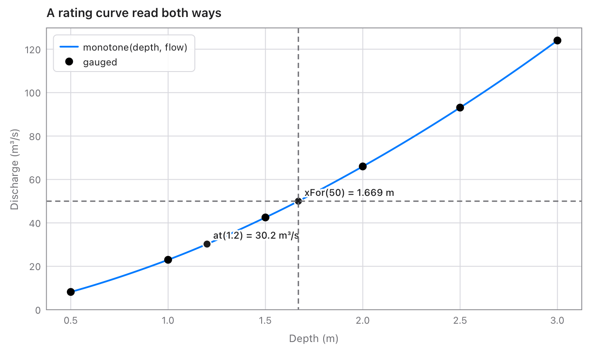
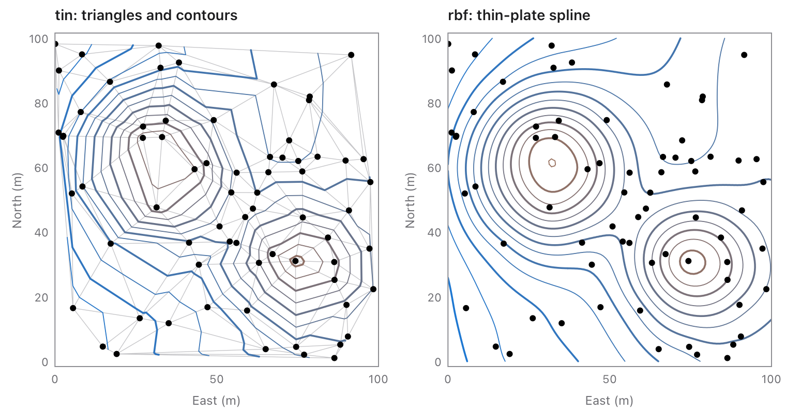
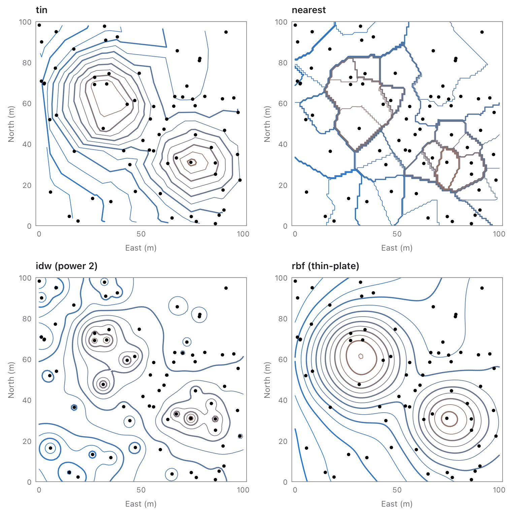
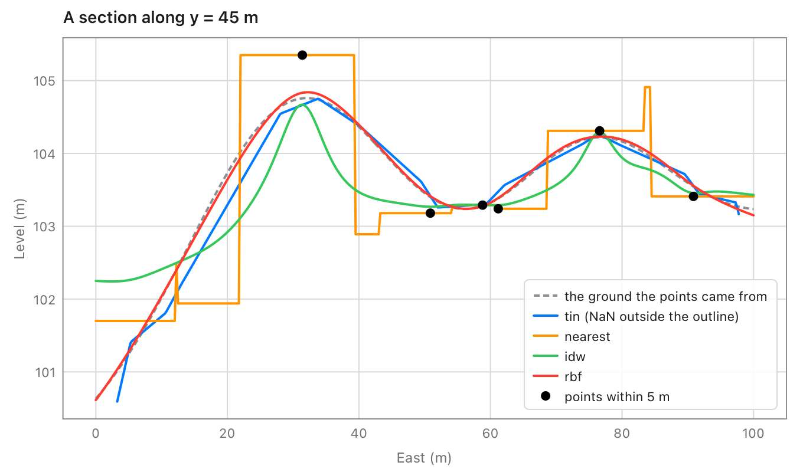

# interpolate

Interpolation for [Tessel](https://tessel-lang.syncster.dev) programs:
values between the points of a table, by straight lines, smooth splines,
a curve that keeps the data's shape, Akima's curve or steps, and two-way
tables. Every curve also gives slopes, areas, and the x for a y (reading a
table backwards). For values at scattered points (boreholes, survey
shots, rain gauges) it makes surfaces: a TIN on Delaunay triangles, the
nearest point, inverse distance weighting, or a thin-plate spline, with
contour lines. Everything is checked against SciPy: 900 random tables,
and 250 triangulations and 294 smooth surfaces of scattered points.

```tessel
import interpolate

fn main() {
    // A rating table: discharge (m³/s) for water depths (m).
    let depth = [0.5, 1.0, 1.5, 2.0, 2.5]
    let flow = [8.2, 23.0, 42.5, 66.0, 93.1]
    let rating = interpolate.monotone(depth, flow)
    print(rating.at(1.2))                    // the flow at 1.2 m
    print(rating.xFor(50.0) ?? 0.0)          // the depth for 50 m³/s
}
```

```text
30.241090785815985
1.6691580566455806
```


## Using it

Add it to a project (Tessel 0.8 or later):

```sh
tessel add interpolate
```

then `import interpolate`.

## Making a curve

Each takes the xs and the ys of the points (in any order; they're sorted
by x) and gives an `Interpolant`.

| Function | The curve |
|---|---|
| `linear(xs, ys)` | Straight lines from point to point, as when reading a table by hand. |
| `spline(xs, ys, start:, end:)` | The smooth cubic spline: no jumps in slope or bending. |
| `monotone(xs, ys)` | Smooth, and keeps the data's shape: rises where the points rise, falls where they fall, never overshoots a point (SciPy's `PchipInterpolator`, MATLAB's `pchip`). The safe choice for tables like rating curves. |
| `akima(xs, ys, modified:)` | Akima's curve: each point's slope leans towards the steadier side, so an odd point doesn't send waves along the curve. `modified: true` is the modified Akima curve (MATLAB's `makima`), which also keeps flat stretches flat. |
| `steps(xs, ys, step:)` | Flat between points: the value of the point before (`.previous`, the default), after (`.next`), or the nearer one (`.nearest`). |

A spline's ends are `.notAKnot` unless you say (as in SciPy and MATLAB):

| `start:` / `end:` | |
|---|---|
| `.notAKnot` | The last three points' pieces are one cubic. |
| `.natural` | No bending at the end (second derivative 0). |
| `.slope(value: v)` | The slope there is `v`. |
| `.bending(value: v)` | The second derivative there is `v`. |

```tessel
let s = interpolate.spline([0, 1, 2, 3], [0, 1, 8, 27])
print(s.at(1.5))     // 3.375000000000001: not-a-knot is exact for a cubic (1.5³)
let n = interpolate.spline([0, 1, 2, 3], [0, 1, 8, 27], start: .natural, end: .natural)
print(n.at(1.5))     // 3.1500000000000004
```

### Outside the points

Every function takes `outside:`, what the curve gives beyond the first and
last point:

| | |
|---|---|
| `.extend` | Goes on with the end pieces' own lines or curves (the default, as in SciPy). |
| `.hold` | Keeps the end values: flat beyond them (the default for steps). |
| `.nan` | `NaN`: no value there. |

## Using a curve

| Method of `Interpolant` | Gives |
|---|---|
| `at(x)` | The value at x. |
| `values(xs)` | The value at each of `xs`. |
| `slope(x)` | The first derivative at x. |
| `secondDerivative(x)` | The second derivative at x. |
| `integral(from:, to:)` | The area under the curve between two xs. |
| `xFor(y)` | The first x between the first and last point where the curve has the value y, or `nil`. |
| `xsFor(y)` | Every such x, smallest first. |

It also has the points it was made from, `xs` and `ys`, and `kind`
(`"linear"`, `"spline"`, `"monotone"`, `"akima"`, `"makima"` or
`"steps"`).

```tessel
// A flood hydrograph (m³/s every 6 hours): its volume in m³.
let hydro = interpolate.linear([0, 6, 12, 18, 24], [20, 80, 310, 520, 450])
print(hydro.integral(from: 0, to: 24) * 3600.0)      // 24732000.0

// Where a wave is at 0.5.
let wave = interpolate.spline([0, 1, 2, 3, 4], [0, 1, 0, -1, 0])
print(wave.xsFor(0.5))       // [0.22360044628468784, 1.6101921598341777]

// An electricity tariff: the rate from each threshold on.
let tariff = interpolate.steps([0, 100, 500], [8.0, 9.5, 11.0])
print(tariff.at(250))        // 9.5
```



## Two-way tables

`grid(xs, ys, zs)` holds a value for each pair of an x and a y: `zs` has a
row for each x, with a value for each y. Its `at(x, y)` interpolates
between the four values around (bilinear, as SciPy's
`RegularGridInterpolator`), and it takes `outside:` too.

```tessel
// Values for x = 0, 10 (rows) and y = 0, 1, 2 (columns).
let g = interpolate.grid([0, 10], [0, 1, 2], [[1, 2, 3], [11, 12, 13]])
print(g.at(5, 1.5))          // 7.5
```

## Scattered points

Values at points that don't sit on a grid, like boreholes, survey shots,
piezometers or rain gauges, make a `Surface` whose `at(x, y)` gives the
value anywhere:

| Maker | |
|---|---|
| `tin(xs, ys, zs, beyond:)` | Flat on each triangle of the points' Delaunay triangulation, like a TIN ground model (SciPy's `griddata`, "linear"). It goes through every point and never above or below them. Outside the points' outline it's `NaN`, or with `beyond: .nearest`, the nearest point's value. |
| `nearest(xs, ys, zs)` | The value of the nearest point (`griddata`, "nearest"): for kinds, like soil types or zones, numbered. |
| `idw(xs, ys, zs, power:, radius:, neighbours:)` | Inverse distance weighting: the mean of the values, each weighted by 1 / distance^`power` (2). `radius` counts only points that near (`NaN` where there are none); `neighbours` only that many of the nearest. Common for rainfall and in GIS. |
| `rbf(xs, ys, zs, kernel:, epsilon:, smoothing:, degree:)` | A smooth surface of radial basis functions (SciPy's `RBFInterpolator`): a thin-plate spline by default, which bends as little as it can. It goes beyond the points and can overshoot them. `smoothing` above 0 lets it miss them, for noisy data. The kernels are `.thinPlate`, `.linear`, `.cubic`, `.quintic`, and, with `epsilon` to scale distances, `.multiquadric`, `.inverseMultiquadric`, `.inverseQuadratic` and `.gaussian`. It solves a system as big as the points: up to about 1000. |

```tessel
// Spot levels from a survey, in metres.
let xs: [Float] = [0, 40, 80, 10, 55, 90, 30, 70]
let ys: [Float] = [0, 5, 0, 45, 40, 50, 90, 85]
let zs: [Float] = [101.2, 102.0, 101.5, 103.4, 104.1, 102.8, 103.0, 104.6]
let ground = interpolate.tin(xs, ys, zs)
print(ground.at(45, 45))                                // 103.886
for line in ground.contours(interpolate.levelsBetween(101, 105, step: 0.5)) {
    print("{line.level} m: {line.points.count / 2} points, closed {line.closed}")
}
```

| `Surface` method | Gives |
|---|---|
| `at(x, y)` | The value at (x, y). |
| `values(xs, ys)` | The value at each pair (xs[k], ys[k]). |
| `onGrid(xs:, ys:)` | The values at every x and y of a grid, as a `Grid`: for rasters, heat maps and contour plots of any surface. |
| `contours(levels)` | For `tin`: the contour lines at each level. |

Points at the same place are merged, with the mean of their values.
`scatteredProblem(xs, ys, zs)` checks points from a file first, as
`problem` does for curves.



The four ways side by side, on the same seventy points (contours every
half metre). `tin` follows the triangles; `nearest` is flat round each
point; `idw` makes rings round them; `rbf` is smooth and runs on past
them:



A section through the four surfaces, with the ground the points were
taken from:



### Triangles and contours

`triangulate(xs, ys)` gives the `Triangulation` on its own: `triangles`
(three point numbers for each, counterclockwise), `halfedges` (each
edge's neighbour the other way, or -1 on the outline), `hull` (the
outline's points, counterclockwise) and `used` (a repeated point is left
out). Its `count()`, `triangle(k)`, `edges()`, `find(x, y)` (the
triangle a point is in, or -1) and `contains(x, y)` read it. It's
SciPy's Delaunay triangulation, and where four points lie on one circle
(as in a grid) it picks one of the two equal ways.

`contours(t, zs, levels:)` gives the contour lines of the surface that's
flat on each triangle, with `zs[k]` at point k, as `Contour`s: `level`,
`points` (x, y, x, y, …) and `closed`. Each line comes out whole, open
where it meets the outline and closed round a hill or a hollow; walking
along it, higher ground is on the left, so rings round hills go
counterclockwise. `levelsBetween(low, high, step:)` gives round levels
to ask for.

## Mistakes

Points that can't make a curve stop the program with a message, like
`interpolate: spline: two points have x = 2.0`: xs and ys of different
lengths, fewer than 2 points, a `NaN` or infinite value, or two points
with the same x. Check data read from a file first with
`interpolate.problem(xs, ys)`, which gives the message or `nil`:

```tessel
print(interpolate.problem([1, 2, 2], [5, 6, 7]) ?? "fine")   // two points have x = 2.0
```

## From version 0.1

`interpolate(p1:p3:y2:)` and `Point` are still here, unchanged: the x on
the straight line through two points at a given y.

```tessel
let a = interpolate.Point(x: 10.0, y: 100.0)
let b = interpolate.Point(x: 20.0, y: 200.0)
print(interpolate.interpolate(p1: a, p3: b, y2: 150.0))   // 15.0
```

For a whole table, `linear(xs, ys).xFor(y)` does the same over every
pair of points.

## Speed

A curve's pieces are worked out once when it's made; each value is then
a binary search and a cubic. On an Apple M5 Pro, a spline through 10 000
points is made in under a millisecond, and a million values take 0.04 s.

For scattered points, 20 000 points are triangulated in 0.04 s, 100 000
values of the TIN take 0.01 s, and a thin-plate spline through 500
points is solved in 0.05 s.

## Tests

```sh
tessel run tests
```

checks the library against SciPy on 900 random tables (750 curves of
every kind and end, 150 grids: 40 900 values, slopes, second
derivatives, areas and crossings, inside and outside the points). Then
scattered points, in 42 232 checks: 250 random sets of up to 600 points
(even, clustered, stretched 1000 to 1, far from the origin like UTM
coordinates, jittered grids), whose triangles and outline must be
SciPy's, with the TIN, nearest and inverse-distance values at points
inside and outside, and Matplotlib's contour lines (how many, how many
closed, how long); and 294 smooth surfaces with every kernel, smoothing
and degree against `RBFInterpolator`. Then the API by hand, including
grids (where the triangles aren't unique), the empty-circle rule,
repeated points, and which way contours run.
`python3 tools/oracle/oracle.py` and `tools/oracle/scattered.py` make the
cases again (`tests/cases.json` and `tests/scattered.json`; they need
numpy and scipy, and the second matplotlib).

## What's where

| File | |
|---|---|
| `fit.tsl` | `linear`, `spline`, `monotone`, `akima`, `steps`, `problem`, and `End`. |
| `curve.tsl` | `Interpolant` and its methods, `Outside` and `Step`. |
| `grid.tsl` | `Grid` and `grid`. |
| `triangulate.tsl` | `Triangulation` and `triangulate`: Delaunay triangles. |
| `scattered.tsl` | `Surface`, `tin`, `nearest`, `idw`, `rbf`, `scatteredProblem`, `Beyond`, `Method` and `Kernel`. |
| `contours.tsl` | `Contour`, `contours` and `levelsBetween`. |
| `interpolate.tsl` | 0.1's `Point` and `interpolate(p1:p3:y2:)`. |
| `tests/` | The tests and the cases from SciPy. |
| `tools/oracle/` | Make the cases from SciPy (`oracle.py` for curves, `scattered.py` for scattered points). |
| `examples/` | Draws the pictures in `docs/` with the [chart](https://chart-package.syncster.dev) library: `tessel run examples`. It's a program of its own, so the library needs no other library. |
| `docs/` | The pictures above. |

## Licence

MIT: see [LICENSE](LICENSE).
